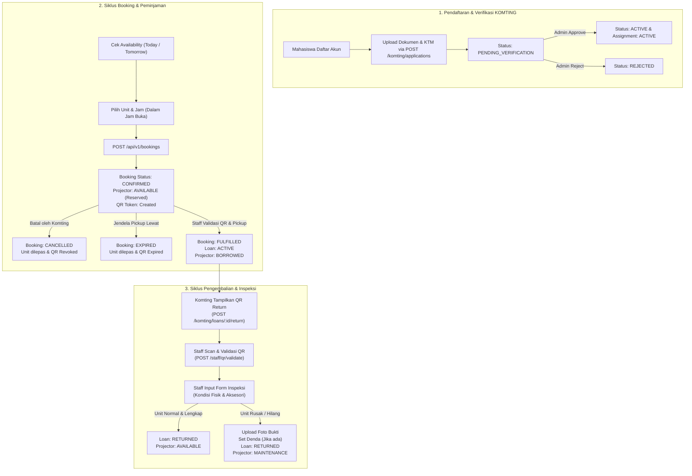

# DOKUMEN HANDOFF BACKEND KE FRONTEND — PINJAM
**Sistem Informasi Peminjaman Proyektor**

- **Versi:** 1.0.0 (Final Backend Handoff)
- **Tanggal:** 27 November 2026
- **Status Backend:** Production-Ready & Tested (Migrations 001–017, Unit Tests 154/154 PASS, Live Supabase Tests PASS)
- **Timezone Aplikasi:** `Asia/Jakarta` (WIB, UTC+07:00)
- **Base URL:** `/api/v1` (dibaca dari `process.env.NEXT_PUBLIC_API_BASE_URL` atau konfigurasi client)

---

## DAFTAR ISI
1. [Ringkasan Eksekutif & Status Kesiapan Backend](#1-ringkasan-eksekutif--status-kesiapan-backend)
2. [Bagian A: Autentikasi & Manajemen Sesi](#bagian-a-autentikasi--manajemen-sesi)
3. [Bagian B: Referensi Lengkap API Endpoint Aktual (37 Endpoints)](#bagian-b-referensi-lengkap-api-endpoint-aktual)
   - [B.1 Autentikasi & Profil Pengguna (4 Endpoints)](#b1-autentikasi--profil-pengguna)
   - [B.2 Pendaftaran & Manajemen KOMTING (8 Endpoints)](#b2-pendaftaran--manajemen-komting)
   - [B.3 Inventaris Proyektor & Jam Operasional (8 Endpoints)](#b3-inventaris-proyektor--jam-operasional)
   - [B.4 Booking & Pickup Proyektor (9 Endpoints)](#b4-booking--pickup-proyektor)
   - [B.5 Peminjaman (Loan), Pengembalian (Return), Inspeksi & Denda (7 Endpoints)](#b5-peminjaman-loan-pengembalian-return-inspeksi--denda)
   - [B.6 Cron & Transactional Notification Outbox (1 Endpoint)](#b6-cron--transactional-notification-outbox)
4. [Bagian C: Alur Bisnis & State Machine (Business Workflows)](#bagian-c-alur-bisnis--state-machine-business-workflows)
5. [Bagian D: Panduan Integrasi Frontend (Frontend Integration Guide)](#bagian-d-panduan-integrasi-frontend-frontend-integration-guide)
6. [Bagian E: Batasan & Ketidaksesuaian Spesifikasi (Known Limitations & Discrepancies)](#bagian-e-batasan--ketidaksesuaian-spesifikasi)

---

## 1. Ringkasan Eksekutif & Status Kesiapan Backend

Backend PINJAM telah menyelesaikan seluruh sprint BE-1 sampai BE-6 dengan fondasi database PostgreSQL Supabase yang mengimplementasikan Row Level Security (RLS), trigger otomatis, dan transaksi atomik via RPC function:
- **Migration 001–010:** Skema inti, RLS policies, trigger `append-only` audit log, constraint integritas, dan sequence siklus hidup.
- **Migration 011–017:** RPC transaksi atomik untuk alur KOMTING, inventaris & jam operasional, booking & pickup, return & denda, serta claiming transactional email outbox (`FOR UPDATE SKIP LOCKED`).
- **Verifikasi Kualitas:** 154 unit tests lulus, Next.js build optimal, dan seluruh live integration test Supabase pada `PINJAM_TESTING` telah terverifikasi 100%.

Frontend dapat beralih dari mock mode (`NEXT_PUBLIC_USE_MOCK_API=false`) ke real backend dengan menghubungkan HTTP client `apiRequest` ke endpoint-endpoint di bawah ini.

---

## Bagian A: Autentikasi & Manajemen Sesi

### A.1 Mekanisme Autentikasi Ganda (Dual Auth Mechanism)
Backend PINJAM mendukung dua metode autentikasi secara transparan:
1. **Cookie-Based Auth (SSR / Next.js Server Components):**
   - Sesi Supabase Auth dikelola otomatis via HttpOnly secure cookies menggunakan `@supabase/ssr`.
   - Cookie dibaca otomatis pada Server Components atau middleware proxy.
2. **Bearer Token Auth (Client-Side SPA / API Client):**
   - Header HTTP: `Authorization: Bearer <access_token>`
   - Diperoleh dari response `POST /api/v1/auth/login` (kolom `session.access_token`).
   - Frontend mendaftarkan provider token ke `setAccessTokenProvider(() => token)` pada `src/lib/api/client.ts`.

### A.2 Model Pengguna & Role Hierarchy
Informasi pengguna pada sesi terikat dengan tabel `public.users`:
- **Role:**
  - `KOMTING`: Mahasiswa penanggung jawab kelas yang berhak membuat booking dan mengambil unit. Wajib memiliki penugasan aktif (`komting_assignment.is_active = true`) untuk bertransaksi.
  - `STAFF`: Petugas operasional inventaris kampus yang memvalidasi QR, menyerahkan proyektor (*pickup*), memeriksa kondisi pengembalian (*return & inspection*), dan menetapkan denda kerusakan/kehilangan.
  - `ADMIN`: Administrator sistem yang memiliki seluruh akses operasional STAFF ditambah hak mengelola akun, menyetujui/menolak pengajuan KOMTING, pergantian komting, jam operasional, dan inventaris proyektor.
- **Account Status (`account_status`):**
  - `ACTIVE`: Akun aktif dan diizinkan mengakses aplikasi sesuai rolenya.
  - `PENDING_VERIFICATION`: Akun baru terdaftar yang menunggu persetujuan admin (misal pendaftar KOMTING).
  - `REJECTED`: Pengajuan pendaftaran ditolak oleh admin.
  - `INACTIVE`: Akun dinonaktifkan oleh admin.

Setiap request ke endpoint yang diproteksi akan mengembalikan `401 AUTH_REQUIRED` jika token tidak valid/hilang, atau `403 FORBIDDEN` jika role atau status akun tidak memenuhi syarat.

---

## Bagian B: Referensi Lengkap API Endpoint Aktual

Seluruh endpoint menggunakan format response standar:
- **Single Item:** `{ "data": T, "meta": { "request_id": string } }`
- **List / Pagination:** `{ "data": T[], "meta": { "request_id": string, "pagination": { "page": number, "page_size": number, "total_items": number, "total_pages": number } } }`
- **Error:** `{ "error": { "code": string, "message": string, "details"?: Array<{ field: string, reason: string }> }, "meta": { "request_id": string } }`

---

### B.1 Autentikasi & Profil Pengguna

#### 1. POST `/api/v1/auth/login`
- **Deskripsi:** Masuk ke sistem menggunakan email dan password.
- **Otorisasi:** Public (Anonim).
- **Request Body:**
  ```json
  {
    "email": "user@example.com",
    "password": "Password123!"
  }
  ```
- **Validasi:** `email` wajib format email valid, `password` wajib string tidak kosong.
- **Response Sukses (200 OK):**
  ```json
  {
    "data": {
      "user": {
        "id": "uuid-user-123",
        "email": "user@example.com",
        "full_name": "Budi Santoso",
        "role": "KOMTING",
        "account_status": "ACTIVE",
        "created_at": "2026-11-20T08:00:00Z",
        "komting_assignment": {
          "id": "uuid-assign-123",
          "class_name": "TI-3A",
          "academic_period": "2026/2027-Ganjil",
          "is_active": true
        }
      },
      "session": {
        "access_token": "eyJhbGciOi...",
        "token_type": "bearer",
        "expires_in": 3600,
        "expires_at": 1798369200,
        "refresh_token": "refresh-token-string"
      }
    },
    "meta": { "request_id": "req_123" }
  }
  ```
- **Response Error:**
  - `400 INVALID_REQUEST`: Format body bukan JSON.
  - `401 INVALID_CREDENTIALS`: Email atau password salah.
  - `403 ACCOUNT_INACTIVE`: Akun berstatus `INACTIVE`, `REJECTED`, atau `PENDING_VERIFICATION`.

#### 2. POST `/api/v1/auth/logout`
- **Deskripsi:** Mengakhiri sesi login pengguna saat ini dan membersihkan cookie/token.
- **Otorisasi:** Authenticated (`KOMTING`, `STAFF`, `ADMIN`).
- **Response Sukses (200 OK):**
  ```json
  {
    "data": { "success": true },
    "meta": { "request_id": "req_123" }
  }
  ```

#### 3. GET `/api/v1/auth/session`
- **Deskripsi:** Memeriksa keabsahan sesi aktif saat ini dan mengembalikan profil pengguna.
- **Otorisasi:** Authenticated (`KOMTING`, `STAFF`, `ADMIN`).
- **Response Sukses (200 OK):**
  ```json
  {
    "data": {
      "authenticated": true,
      "user": {
        "id": "uuid-user-123",
        "email": "user@example.com",
        "full_name": "Budi Santoso",
        "role": "KOMTING",
        "account_status": "ACTIVE",
        "komting_assignment": { ... }
      }
    },
    "meta": { "request_id": "req_123" }
  }
  ```
- **Response Error:** `401 AUTH_REQUIRED`.

#### 4. GET `/api/v1/me`
- **Deskripsi:** Mengambil data profil lengkap pengguna yang sedang login.
- **Otorisasi:** Authenticated (`KOMTING`, `STAFF`, `ADMIN`).
- **Response Sukses (200 OK):** Sama dengan struktur objek `user` pada login.

#### 5. PATCH `/api/v1/me`
- **Deskripsi:** Memperbarui data profil pengguna (hanya nama lengkap).
- **Otorisasi:** Authenticated (`KOMTING`, `STAFF`, `ADMIN`).
- **Request Body:**
  ```json
  {
    "full_name": "Budi Santoso S.Kom"
  }
  ```
- **Validasi:** `full_name` wajib string, panjang 2–120 karakter. Tidak mengizinkan field lain (`FIELD_NOT_ALLOWED`).
- **Response Sukses (200 OK):** Profil `user` yang telah diperbarui.

---

### B.2 Pendaftaran & Manajemen KOMTING

#### 6. POST `/api/v1/komting/applications`
- **Deskripsi:** Mahasiswa mengajukan diri sebagai KOMTING untuk kelasnya.
- **Otorisasi:** Role `KOMTING` (yang belum memiliki penugasan aktif).
- **Format Request:** `multipart/form-data`
- **Form Fields:**
  - `class_name` (string, wajib, contoh: "TI-3A")
  - `academic_period` (string, wajib, contoh: "2026/2027-Ganjil")
  - `whatsapp_number` (string, wajib, format: `08...` atau `+62...`, 9–15 digit)
  - `ktm_file` (File binary, wajib, format: JPEG/PNG/PDF, ukuran maks: 5 MB)
- **Response Sukses (201 Created):**
  ```json
  {
    "data": {
      "application_id": "uuid-app-123",
      "status": "PENDING_VERIFICATION",
      "submitted_at": "2026-11-27T08:00:00Z"
    },
    "meta": { "request_id": "req_123" }
  }
  ```
- **Response Error:**
  - `400 INVALID_REQUEST`: File tidak valid atau field kurang.
  - `409 ACTIVE_ASSIGNMENT_EXISTS`: Pengguna sudah memiliki penugasan aktif.
  - `409 PENDING_APPLICATION_EXISTS`: Masih ada pengajuan berstatus pending.
  - `422 INVALID_FILE_TYPE` / `FILE_TOO_LARGE`: KTM bukan JPEG/PNG/PDF atau > 5MB.

#### 7. GET `/api/v1/komting/applications/me`
- **Deskripsi:** Melihat riwayat pengajuan KOMTING milik sendiri beserta status verifikasinya.
- **Otorisasi:** Role `KOMTING`.
- **Response Sukses (200 OK):**
  ```json
  {
    "data": {
      "id": "uuid-app-123",
      "class_name": "TI-3A",
      "academic_period": "2026/2027-Ganjil",
      "whatsapp_number": "081234567890",
      "status": "PENDING_VERIFICATION",
      "rejection_reason": null,
      "created_at": "2026-11-27T08:00:00Z"
    },
    "meta": { "request_id": "req_123" }
  }
  ```

#### 8. GET `/api/v1/admin/komting/applications`
- **Deskripsi:** Admin melihat daftar seluruh pengajuan KOMTING yang masuk.
- **Otorisasi:** Role `ADMIN`.
- **Query Parameters:**
  - `status` (opsional: `PENDING_VERIFICATION`, `APPROVED`, `REJECTED`)
  - `page` (default: 1)
  - `page_size` (default: 20, max: 100)
  - `sort_by` (default: `created_at`)
  - `sort_order` (`asc` | `desc`)
- **Response Sukses (200 OK):** List of applications with pagination metadata.

#### 9. GET `/api/v1/admin/komting/applications/[applicationId]`
- **Deskripsi:** Admin melihat detail pengajuan tertentu beserta URL aman foto KTM.
- **Otorisasi:** Role `ADMIN`.
- **Response Sukses (200 OK):** Mengembalikan data pengajuan lengkap dan `ktm_signed_url` yang memiliki masa berlaku terbatas.

#### 10. POST `/api/v1/admin/komting/applications/[applicationId]/approve`
- **Deskripsi:** Admin menyetujui pengajuan KOMTING baru (kelas belum memiliki KOMTING aktif).
- **Otorisasi:** Role `ADMIN`.
- **Request Body:**
  ```json
  {
    "admin_note": "Dokumen KTM valid dan terverifikasi"
  }
  ```
- **Response Sukses (200 OK):**
  ```json
  {
    "data": {
      "application_id": "uuid-app-123",
      "status": "APPROVED",
      "assignment": {
        "id": "uuid-assign-123",
        "status": "ACTIVE",
        "class_name": "TI-3A"
      }
    },
    "meta": { "request_id": "req_123" }
  }
  ```
- **Response Error:** `409 CLASS_ALREADY_HAS_ACTIVE_KOMTING`: Kelas sudah memiliki komting aktif (harus menggunakan endpoint `approve-replacement`).

#### 11. POST `/api/v1/admin/komting/applications/[applicationId]/approve-replacement`
- **Deskripsi:** Admin menyetujui pengajuan pergantian KOMTING (menggantikan KOMTING lama pada kelas tersebut).
- **Otorisasi:** Role `ADMIN`.
- **Request Body:** Sama dengan approve (`admin_note`).
- **Response Sukses (200 OK):** Atomik menonaktifkan komting lama (`status = 'REPLACED'`), mengaktifkan komting baru (`status = 'ACTIVE'`), dan menjadwalkan notifikasi email outbox ke kedua pihak.

#### 12. POST `/api/v1/admin/komting/applications/[applicationId]/reject`
- **Deskripsi:** Admin menolak pengajuan KOMTING.
- **Otorisasi:** Role `ADMIN`.
- **Request Body:**
  ```json
  {
    "reason": "Foto KTM buram dan tidak terbaca."
  }
  ```
- **Validasi:** `reason` wajib string minimal 5 karakter.
- **Response Sukses (200 OK):** Mengembalikan data aplikasi dengan status `REJECTED`.

#### 13. POST `/api/v1/admin/komting/assignments/[assignmentId]/deactivate`
- **Deskripsi:** Admin menonaktifkan jabatan KOMTING yang sedang aktif sebelum periode berakhir.
- **Otorisasi:** Role `ADMIN`.
- **Request Body:**
  ```json
  {
    "reason": "Mahasiswa mengundurkan diri / cuti."
  }
  ```
- **Response Sukses (200 OK):** Status assignment berubah menjadi `INACTIVE` dan role pengguna kembali menjadi non-aktif.

---

### B.3 Inventaris Proyektor & Jam Operasional

#### 14. GET `/api/v1/projectors`
- **Deskripsi:** Mengambil daftar proyektor dan status fisiknya.
- **Otorisasi:** Authenticated (`KOMTING`, `STAFF`, `ADMIN`).
- **Query Parameters:**
  - `physical_status` (opsional: `AVAILABLE`, `BORROWED`, `MAINTENANCE`, `INACTIVE`)
  - `page`, `page_size`, `sort_by`, `sort_order`
- **Response Sukses (200 OK):**
  ```json
  {
    "data": [
      {
        "id": "uuid-proj-1",
        "asset_code": "PRJ-001",
        "name": "Epson EB-X400 Ruang Teori 1",
        "brand": "Epson",
        "model": "EB-X400",
        "physical_status": "AVAILABLE",
        "is_active": true
      }
    ],
    "meta": { "pagination": { ... } }
  }
  ```

#### 15. GET `/api/v1/projectors/[projectorId]`
- **Deskripsi:** Mengambil detail spesifik unit proyektor.
- **Otorisasi:** Authenticated (`KOMTING`, `STAFF`, `ADMIN`).
- **Response Sukses (200 OK):** Data unit proyektor tunggal.

#### 16. POST `/api/v1/admin/projectors`
- **Deskripsi:** Admin mendaftarkan unit proyektor baru.
- **Otorisasi:** Role `ADMIN`.
- **Request Body:**
  ```json
  {
    "asset_code": "PRJ-010",
    "name": "BenQ MW535 Ruang Sidang",
    "brand": "BenQ",
    "model": "MW535"
  }
  ```
- **Validasi:** `asset_code` unik, `name` wajib minimal 3 karakter.
- **Response Sukses (201 Created):** Objek unit proyektor baru.
- **Response Error:** `409 ASSET_CODE_ALREADY_EXISTS`.

#### 17. PATCH `/api/v1/admin/projectors/[projectorId]`
- **Deskripsi:** Admin memperbarui informasi unit proyektor (nama, brand, model).
- **Otorisasi:** Role `ADMIN`.
- **Request Body:** Partial pick `name`, `brand`, `model`.
- **Response Sukses (200 OK):** Objek unit proyektor yang diperbarui.

#### 18. POST `/api/v1/admin/projectors/[projectorId]/deactivate`
- **Deskripsi:** Admin menonaktifkan unit proyektor dari inventaris aktif.
- **Otorisasi:** Role `ADMIN`.
- **Response Sukses (200 OK):** Proyektor diatur `is_active = false` dan `physical_status = 'INACTIVE'`.
- **Response Error:** `409 CANNOT_DEACTIVATE_BORROWED`: Unit sedang berstatus `BORROWED` (harus dikembalikan terlebih dahulu).

#### 19. GET `/api/v1/operating-hours`
- **Deskripsi:** Mengambil snapshot jam operasional untuk tanggal tertentu.
- **Otorisasi:** Authenticated (`KOMTING`, `STAFF`, `ADMIN`).
- **Query Parameter:** `date=YYYY-MM-DD` (wajib).
- **Response Sukses (200 OK):**
  ```json
  {
    "data": {
      "date": "2026-11-28",
      "day_of_week": "SATURDAY",
      "opens_at": "08:00:00",
      "closes_at": "16:00:00",
      "admin_early_open_at": null,
      "is_closed": false,
      "note": null
    },
    "meta": { "request_id": "req_123" }
  }
  ```

#### 20. PUT `/api/v1/admin/operating-hours/[date]`
- **Deskripsi:** Admin memperbarui atau meng-override jam operasional pada tanggal tertentu (misal hari libur nasional atau jam khusus).
- **Otorisasi:** Role `ADMIN`.
- **URL Param:** `date=YYYY-MM-DD`.
- **Request Body:**
  ```json
  {
    "opens_at": "07:30:00",
    "closes_at": "15:00:00",
    "admin_early_open_at": "07:00:00",
    "is_closed": false,
    "note": "Jadwal Ujian Akhir Semester"
  }
  ```
- **Validasi:** `opens_at` harus sebelum `closes_at`.
- **Response Sukses (200 OK):** Objek jam operasional yang telah diperbarui.

#### 21. GET `/api/v1/availability`
- **Deskripsi:** Memeriksa ketersediaan proyektor pada rentang jam di tanggal yang diminta.
- **Otorisasi:** Authenticated (`KOMTING`, `STAFF`, `ADMIN`).
- **Query Parameters:**
  - `date=YYYY-MM-DD` (wajib)
  - `start_time=HH:mm:ss` (wajib)
  - `end_time=HH:mm:ss` (wajib)
  - `projector_id=uuid` (opsional, jika ingin memeriksa unit spesifik)
- **Response Sukses (200 OK):**
  ```json
  {
    "data": {
      "date": "2026-11-28",
      "start_time": "09:00:00",
      "end_time": "12:00:00",
      "total_available": 5,
      "available_projectors": [
        { "id": "uuid-1", "name": "Epson Ruang 1", "asset_code": "PRJ-001" }
      ],
      "unavailable_projectors": []
    },
    "meta": { "request_id": "req_123" }
  }
  ```

---

### B.4 Booking & Pickup Proyektor

#### 22. POST `/api/v1/bookings` (dan POST `/api/v1/komting/bookings`)
- **Deskripsi:** KOMTING membuat reservasi proyektor untuk hari ini atau besok.
- **Otorisasi:** Role `KOMTING` dengan penugasan kelas aktif.
- **Header Opsional:** `Idempotency-Key: <unique-uuid-string>` (Disarankan untuk mencegah duplikasi order akibat double-click).
- **Request Body:**
  ```json
  {
    "projector_id": "uuid-proj-1",
    "booking_date": "2026-11-28",
    "start_time": "09:00:00",
    "estimated_return_at": "2026-11-28T12:00:00+07:00"
  }
  ```
- **Aturan Validasi Bisnis:**
  - Tanggal booking hanya boleh untuk **Hari Ini** atau **Besok** (waktu Jakarta).
  - Waktu mulai dan selesai wajib berada dalam jam operasional kampus.
  - KOMTING tidak boleh memiliki booking atau loan yang sedang aktif (maks 1 transaksi aktif per komting).
  - Unit proyektor tidak boleh bentrok dengan booking atau loan lain pada rentang waktu yang sama.
- **Response Sukses (201 Created):**
  ```json
  {
    "data": {
      "id": "uuid-bkg-123",
      "booking_code": "BKG-20261128-001",
      "status": "CONFIRMED",
      "projector_id": "uuid-proj-1",
      "booking_date": "2026-11-28",
      "start_time": "09:00:00",
      "estimated_return_at": "2026-11-28T12:00:00Z",
      "pickup_window": {
        "opens_at": "2026-11-28T08:45:00Z",
        "closes_at": "2026-11-28T09:15:00Z"
      },
      "created_at": "2026-11-27T10:00:00Z"
    },
    "meta": { "request_id": "req_123" }
  }
  ```
- **Response Error:**
  - `409 ACTIVE_BOOKING_EXISTS`: Komting masih memiliki booking aktif.
  - `409 PROJECTOR_NOT_AVAILABLE`: Unit proyektor telah terbooking pada jam tersebut.
  - `422 DATE_OUT_OF_WINDOW`: Tanggal bukan hari ini atau besok.
  - `422 TIME_OUTSIDE_OPERATING_HOURS`: Di luar jam buka.

#### 23. GET `/api/v1/komting/bookings`
- **Deskripsi:** KOMTING melihat riwayat booking milik kelasnya.
- **Otorisasi:** Role `KOMTING` aktif.
- **Query Parameters:** `status` (`CONFIRMED`, `FULFILLED`, `CANCELLED`, `EXPIRED`), `page`, `page_size`.
- **Response Sukses (200 OK):** Daftar booking dan pagination.

#### 24. GET `/api/v1/komting/bookings/[bookingId]`
- **Deskripsi:** KOMTING melihat detail booking miliknya.
- **Otorisasi:** Role `KOMTING` (pemilik booking).
- **Response Sukses (200 OK):** Objek booking lengkap beserta status unit dan jendela pickup.

#### 25. POST `/api/v1/komting/bookings/[bookingId]/cancel`
- **Deskripsi:** KOMTING membatalkan booking yang berstatus `CONFIRMED`.
- **Otorisasi:** Role `KOMTING` (pemilik booking).
- **Request Body:**
  ```json
  {
    "reason": "Dosen berhalangan hadir, kelas ditiadakan."
  }
  ```
- **Validasi:** `reason` minimal 3 karakter. Hanya dapat dibatalkan jika status masih `CONFIRMED`.
- **Response Sukses (200 OK):** Status booking berubah menjadi `CANCELLED`, unit proyektor langsung dilepas menjadi tersedia, dan QR token di-revoke secara atomik.

#### 26. GET `/api/v1/komting/bookings/[bookingId]/qr`
- **Deskripsi:** Mengambil string payload QR dan visualisasi kode untuk discan oleh staff saat pickup.
- **Otorisasi:** Role `KOMTING` (pemilik booking).
- **Response Sukses (200 OK):**
  ```json
  {
    "data": {
      "booking_id": "uuid-bkg-123",
      "qr_payload": "PINJAM_QR_PAYLOAD_STRING...",
      "expires_at": "2026-11-28T09:15:00Z",
      "is_valid": true
    },
    "meta": { "request_id": "req_123" }
  }
  ```

#### 27. GET `/api/v1/staff/bookings`
- **Deskripsi:** Staff melihat daftar seluruh booking proyektor kampus.
- **Otorisasi:** Role `STAFF` atau `ADMIN`.
- **Query Parameters:** `date=YYYY-MM-DD`, `status`, `page`, `page_size`.
- **Response Sukses (200 OK):** List of bookings with KOMTING details and projector asset code.

#### 28. GET `/api/v1/staff/bookings/[bookingId]`
- **Deskripsi:** Staff melihat detail spesifik transaksi booking.
- **Otorisasi:** Role `STAFF` atau `ADMIN`.
- **Response Sukses (200 OK):** Detail booking, data KOMTING, kelas, nomor WhatsApp, dan proyektor.

#### 29. POST `/api/v1/staff/qr/validate`
- **Deskripsi:** Staff memindai QR code mahasiswa dari kamera pemindai untuk memvalidasi keabsahan QR sebelum konfirmasi.
- **Otorisasi:** Role `STAFF` atau `ADMIN`.
- **Request Body:**
  ```json
  {
    "qr_payload": "PINJAM_QR_PAYLOAD_STRING...",
    "action": "PICKUP"
  }
  ```
- **Validasi:** `action` bernilai `PICKUP` atau `RETURN`.
- **Response Sukses (200 OK):**
  ```json
  {
    "data": {
      "valid": true,
      "action": "PICKUP",
      "transaction": {
        "booking_id": "uuid-bkg-123",
        "booking_code": "BKG-20261128-001",
        "komting_name": "Budi Santoso",
        "class_name": "TI-3A",
        "projector_name": "Epson Ruang 1",
        "status": "CONFIRMED"
      },
      "requires_confirmation": true
    },
    "meta": { "request_id": "req_123" }
  }
  ```
- **Response Error:**
  - `422 QR_EXPIRED`: QR telah melewati batas waktu pickup (tutup).
  - `422 QR_REVOKED`: Booking telah dibatalkan sebelumnya.
  - `422 QR_ACTION_MISMATCH`: QR bukan untuk alur pickup.

#### 30. POST `/api/v1/staff/bookings/[bookingId]/pickup`
- **Deskripsi:** Staff mengonfirmasi penyerahan proyektor ke komting/perwakilan.
- **Otorisasi:** Role `STAFF` atau `ADMIN`.
- **Header Opsional:** `Idempotency-Key: <unique-uuid>`
- **Request Body:**
  ```json
  {
    "qr_payload": "PINJAM_QR_PAYLOAD_STRING...",
    "confirmed": true,
    "received_by": "KOMTING",
    "representative_name": null,
    "note": "Kondisi unit lengkap sebelum diserahkan"
  }
  ```
  *(Catatan: Jika `received_by` bernilai `REPRESENTATIVE`, maka `representative_name` wajib diisi).*
- **Response Sukses (200 OK):**
  ```json
  {
    "data": {
      "booking": { "id": "uuid-bkg-123", "status": "FULFILLED" },
      "loan": { "id": "uuid-loan-123", "status": "ACTIVE", "borrowed_at": "2026-11-28T08:50:00Z" },
      "projector": { "id": "uuid-proj-1", "physical_status": "BORROWED" }
    },
    "meta": { "request_id": "req_123" }
  }
  ```

---

### B.5 Peminjaman (Loan), Pengembalian (Return), Inspeksi & Denda

#### 31. GET `/api/v1/komting/loans`
- **Deskripsi:** KOMTING melihat riwayat peminjaman proyektor kelasnya.
- **Otorisasi:** Role `KOMTING` aktif.
- **Query Parameters:** `status` (`ACTIVE`, `RETURNED`), `page`, `page_size`.
- **Response Sukses (200 OK):** Daftar loan dan status durasi pinjam.

#### 32. GET `/api/v1/komting/loans/[loanId]`
- **Deskripsi:** KOMTING melihat detail peminjaman aktif beserta estimasi batas waktu pengembalian.
- **Otorisasi:** Role `KOMTING` (pemilik loan).
- **Response Sukses (200 OK):** Detail data loan, nama unit proyektor, waktu peminjaman, dan estimasi waktu kembali.

#### 33. POST `/api/v1/komting/loans/[loanId]/return`
- **Deskripsi:** KOMTING menginisiasi alur pengembalian untuk memunculkan QR Return kepada staff.
- **Otorisasi:** Role `KOMTING` (pemilik loan).
- **Response Sukses (200 OK):**
  ```json
  {
    "data": {
      "loan_id": "uuid-loan-123",
      "qr_payload": "PINJAM_RETURN_QR_STRING...",
      "status": "ACTIVE",
      "ready_for_inspection": true
    },
    "meta": { "request_id": "req_123" }
  }
  ```

#### 34. GET `/api/v1/staff/loans`
- **Deskripsi:** Staff melihat daftar seluruh peminjaman yang sedang aktif atau sudah selesai.
- **Otorisasi:** Role `STAFF` atau `ADMIN`.
- **Query Parameters:** `status` (`ACTIVE`, `RETURNED`), `page`, `page_size`.
- **Response Sukses (200 OK):** Daftar loan beserta indikator keterlambatan (`is_overdue`).

#### 35. GET `/api/v1/staff/loans/[loanId]`
- **Deskripsi:** Staff melihat detail loan lengkap sebelum melakukan pemeriksaan pengembalian.
- **Otorisasi:** Role `STAFF` atau `ADMIN`.
- **Response Sukses (200 OK):** Data peminjaman, komting, nomor kontak, unit proyektor, dan catatan pickup.

#### 36. GET `/api/v1/staff/loans/[loanId]/return`
- **Deskripsi:** Mengambil kalkulasi preview pengembalian secara real-time (cek apakah terlambat, kalkulasi menit keterlambatan).
- **Otorisasi:** Role `STAFF` atau `ADMIN`.
- **Response Sukses (200 OK):**
  ```json
  {
    "data": {
      "loan_id": "uuid-loan-123",
      "is_overdue": true,
      "overdue_minutes": 15,
      "estimated_return_at": "2026-11-28T12:00:00Z",
      "current_time": "2026-11-28T12:15:00Z"
    },
    "meta": { "request_id": "req_123" }
  }
  ```

#### 37. POST `/api/v1/staff/loans/[loanId]/return`
- **Deskripsi:** Staff mengonfirmasi pengembalian proyektor, hasil inspeksi fisik & kelengkapan aksesori, disposisi unit, serta penetapan denda (jika ada).
- **Otorisasi:** Role `STAFF` atau `ADMIN`.
- **Header Opsional:** `Idempotency-Key: <unique-uuid>`
- **Format Payload:** Mendukung `application/json` ATAU `multipart/form-data` (jika mengunggah foto bukti fisik).
- **Fields:**
  - `qr_payload` (string, wajib)
  - `returned_by` (string, wajib: `KOMTING` atau `REPRESENTATIVE`)
  - `representative_name` (string, wajib jika `returned_by === 'REPRESENTATIVE'`)
  - `projector_condition` (string, wajib: `NORMAL` atau `DAMAGED`)
  - `accessories_condition` (string, wajib: `COMPLETE` atau `INCOMPLETE`)
  - `unit_disposition` (string, wajib: `AVAILABLE` atau `MAINTENANCE`)
  - `evidence_photo` (File binary, wajib jika `projector_condition === 'DAMAGED'` atau `accessories_condition === 'INCOMPLETE'`)
  - `note` (string, opsional)
  - `fine_amount` (number, opsional, default 0; wajib >= 0)
  - `fine_notes` (string, wajib jika `fine_amount > 0`)
- **Aturan Validasi Bisnis:**
  - Jika kondisi unit `DAMAGED`, `unit_disposition` wajib bernilai `MAINTENANCE` dan foto bukti wajib disertakan.
  - Jika kondisi unit `NORMAL` dan aksesori `COMPLETE`, tidak boleh menetapkan `fine_amount > 0`.
- **Response Sukses (200 OK):**
  ```json
  {
    "data": {
      "loan": { "id": "uuid-loan-123", "status": "RETURNED", "returned_at": "2026-11-28T12:15:00Z" },
      "inspection": {
        "projector_condition": "NORMAL",
        "accessories_condition": "COMPLETE",
        "unit_disposition": "AVAILABLE"
      },
      "projector": { "id": "uuid-proj-1", "physical_status": "AVAILABLE" },
      "fine": {
        "fine_type": "LATE_RETURN",
        "amount": 0,
        "overdue_minutes": 15
      }
    },
    "meta": { "request_id": "req_123" }
  }
  ```

#### 38. GET `/api/v1/staff/loans/[loanId]/inspection`
- **Deskripsi:** Melihat riwayat detail hasil inspeksi fisik dan foto bukti dari peminjaman yang telah dikembalikan.
- **Otorisasi:** Role `STAFF` atau `ADMIN`.
- **Response Sukses (200 OK):** Hasil inspeksi lengkap dengan signed photo URL (jika ada bukti foto yang diunggah).

---

### B.6 Cron & Transactional Notification Outbox

#### 39. GET `/api/v1/cron/email-outbox`
- **Deskripsi:** Health check dan ringkasan antrean outbox transactional email (`pending`, `processing`, `sent`, `failed`, `total`).
- **Otorisasi:** Bearer token `CRON_SECRET` atau header `x-cron-secret` ATAU pengguna dengan role `ADMIN`.
- **Response Sukses (200 OK):**
  ```json
  {
    "data": {
      "pending": 2,
      "processing": 0,
      "sent": 75,
      "failed": 0,
      "total": 77
    },
    "meta": { "request_id": "req_123" }
  }
  ```

#### 40. POST `/api/v1/cron/email-outbox`
- **Deskripsi:** Memicu pemrosesan batch antrean outbox email secara asynchronous dengan proteksi konkurensi `FOR UPDATE SKIP LOCKED`.
- **Otorisasi:** `CRON_SECRET` atau role `ADMIN`.
- **Query / Body Params:** `batch_size` (default 10, max 50), `max_attempts` (default 5).
- **Response Sukses (200 OK):**
  ```json
  {
    "data": {
      "claimed": 2,
      "processed": 2,
      "sent": 2,
      "failed": 0,
      "retried": 0,
      "durationMs": 142
    },
    "meta": { "request_id": "req_123" }
  }
  ```

---

## Bagian C: Alur Bisnis & State Machine (Business Workflows)



### Aturan Bisnis Kunci yang Wajib Dipatuhi Frontend:
1. **Window Booking (Hanya Hari Ini & Besok):**
   Frontend tidak boleh mengizinkan pemilihan tanggal di luar hari ini atau besok. Backend memvalidasi terhadap tanggal kalender di zona waktu `Asia/Jakarta`.
2. **Jendela Pengambilan (Pickup Window):**
   - Dibuka: 15 menit sebelum `start_time` booking.
   - Ditutup: 15 menit setelah `start_time` booking.
   - Jika melewati waktu tutup, QR otomatis kedaluwarsa dan booking dianggap hangus (*expired*).
3. **Batas Satu Transaksi Aktif:**
   Seorang KOMTING tidak dapat membuat booking baru jika masih memiliki booking berstatus `CONFIRMED` atau peminjaman yang berstatus `ACTIVE`.
4. **Disposisi Kerusakan Proyektor:**
   Jika staff memilih `projector_condition = 'DAMAGED'`, sistem secara otomatis mewajibkan:
   - `unit_disposition = 'MAINTENANCE'` (tidak boleh diset `AVAILABLE`).
   - Melampirkan foto bukti fisik (`evidence_photo`).

---

## Bagian D: Panduan Integrasi Frontend (Frontend Integration Guide)

### D.1 Inisialisasi API Client & Sesi Token

File client [src/lib/api/client.ts](file:///Users/user/Desktop/TUGAS_KEEGAN%20/SEM%203/BLOK%202/Metode%20Numerik/PINJAM/src/lib/api/client.ts) telah siap digunakan dan mengimplementasikan seluruh konvensi PINJAM:

```typescript
import { apiRequest, setAccessTokenProvider } from "@/lib/api/client";
import type { Booking, UserProfile } from "@/types/domain";

// 1. Daftarkan provider token saat aplikasi frontend diinisialisasi
let currentToken: string | null = null;
export function updateSessionToken(token: string | null) {
  currentToken = token;
}
setAccessTokenProvider(() => currentToken);

// 2. Contoh Pemanggilan Endpoint GET
export async function fetchMyProfile(): Promise<UserProfile> {
  const response = await apiRequest<{ data: UserProfile }>("/me");
  return response.data;
}

// 3. Contoh Pemanggilan Endpoint Mutasi dengan Idempotency-Key
export async function bookProjector(payload: {
  projector_id: string;
  booking_date: string;
  start_time: string;
  estimated_return_at: string;
}): Promise<Booking> {
  const idempotencyKey = crypto.randomUUID(); // Buat UUID unik per klik form
  const response = await apiRequest<{ data: Booking }>("/bookings", {
    method: "POST",
    body: payload,
    idempotencyKey,
  });
  return response.data;
}

// 4. Contoh Pemanggilan Endpoint Upload File (multipart/form-data)
export async function uploadKomtingApplication(formData: FormData) {
  // Jangan set header "Content-Type" secara manual!
  // Browser akan menyematkan boundary multipart otomatis.
  const response = await apiRequest<{ data: { application_id: string } }>("/komting/applications", {
    method: "POST",
    formData,
  });
  return response.data;
}
```

### D.2 Penanganan Error Standar
Gunakan class `ApiClientError` dari [src/lib/api/errors.ts](file:///Users/user/Desktop/TUGAS_KEEGAN%20/SEM%203/BLOK%202/Metode%20Numerik/PINJAM/src/lib/api/errors.ts):
```typescript
import { ApiClientError } from "@/lib/api/errors";

try {
  await bookProjector(formState);
} catch (error) {
  if (error instanceof ApiClientError) {
    switch (error.code) {
      case "ACTIVE_BOOKING_EXISTS":
        showToast("Anda masih memiliki booking aktif yang belum selesai.", "warning");
        break;
      case "PROJECTOR_NOT_AVAILABLE":
        showToast("Proyektor telah dipesan orang lain pada jam tersebut.", "error");
        break;
      case "DATE_OUT_OF_WINDOW":
        showToast("Pemesanan hanya diizinkan untuk hari ini atau besok.", "error");
        break;
      default:
        showToast(error.message, "error");
    }
  }
}
```

### D.3 Rekomendasi Urutan Integrasi Halaman (Recommended Sequence)
1. **Langkah 1: Autentikasi & Guard Navigasi (`/login`, `/auth/session`)**
   - Hubungkan form login ke `POST /api/v1/auth/login`.
   - Simpan token dan arahkan ke dashboard berdasarkan `user.role`.
2. **Langkah 2: Pendaftaran KOMTING (`/komting/register`, `/komting/applications`)**
   - Formulir pengajuan KOMTING dengan upload KTM (`multipart/form-data`).
3. **Langkah 3: Dashboard & Availability KOMTING (`/komting/dashboard`, `/availability`)**
   - Komponen pemilih tanggal & jam operasional (`GET /api/v1/operating-hours`).
   - Tampilan ketersediaan proyektor real-time (`GET /api/v1/availability`).
4. **Langkah 4: Booking & QR Pickup (`/komting/bookings`, `/komting/bookings/:id/qr`)**
   - Form pemesanan dengan `Idempotency-Key`.
   - Halaman detail tiket booking dengan display QR code untuk staff.
5. **Langkah 5: Portal Staff Scanner & Pickup (`/staff/scan`, `/staff/bookings/:id/pickup`)**
   - Integrasi kamera scanner QR ke `POST /api/v1/staff/qr/validate`.
   - Dialog konfirmasi penyerahan unit proyektor.
6. **Langkah 6: Portal Staff Return & Inspeksi (`/staff/loans/:id/return`)**
   - Tampilan checklist kondisi fisik dan kelengkapan kabel/remote.
   - Upload foto bukti jika rusak dan penetapan denda.
7. **Langkah 7: Portal Admin (`/admin/komting`, `/admin/projectors`, `/admin/hours`)**
   - Verifikasi pengajuan KOMTING (Approve / Reject / Replace).
   - CRUD unit inventaris proyektor dan pengaturan jam buka-tutup kampus.

### D.4 Desain UI Neubrutalism: Penanganan State
Sesuai arahan [FRONTEND_SPEC_PINJAM.md](file:///Users/user/Desktop/TUGAS_KEEGAN%20/SEM%203/BLOK%202/Metode%20Numerik/PINJAM/FRONTEND_SPEC_PINJAM.md):
- **Loading State:** Gunakan skeleton card dengan border solid `2px` dan shadow keras `4px 4px 0 #171717`. Hindari animasi shimmer gradient lembut.
- **Empty State:** Tampilkan ilustrasi/ikon sederhana dengan tombol aksi tegas berlatar warna primer (`#c8f169`).
- **Error State:** Tampilkan pesan error jelas dengan latar warna aksen (`#ff6b6b`), sebutkan kode error teknis di bawah pesan untuk memudahkan pelaporan jika terjadi kendala.

---

## Bagian E: Batasan & Ketidaksesuaian Spesifikasi (Known Limitations & Discrepancies)

Perhatikan catatan ketidaksesuaian antara spesifikasi awal (*early drafts*) dan implementasi backend aktual:

1. **Penetapan Denda (*Fine Assessment*):**
   - *Draft Awal:* `API_CONTRACT_PINJAM.md §2.2` menyatakan denda uang tidak diterapkan.
   - *Implementasi Aktual:* Mengikuti revisi resmi **Sprint BE-5**, tabel `loan_fines` telah aktif (Migration 016). Endpoint `POST /api/v1/staff/loans/:id/return` menerima `fine_amount` dan `fine_notes`. Frontend staff wajib menampilkan input denda jika kondisi unit rusak atau hilang.
2. **Endpoint Maintenance Khusus Terpisah:**
   - *Draft Awal:* `src/services/api/api-services.ts` mencantumkan stub `/staff/maintenance`.
   - *Implementasi Aktual:* Alur pemeliharaan unit terintegrasi langsung dalam siklus pengembalian (`staff/loans/:id/return`) dengan menyetel `unit_disposition = 'MAINTENANCE'`, atau penonaktifan unit oleh admin (`admin/projectors/:id/deactivate`).
3. **Endpoint Dashboard Khusus:**
   - Endpoint `/komting/dashboard` dan `/staff/dashboard` belum memiliki handler terpisah; frontend mengambil data agregasi secara langsung melalui kombinasi endpoint listing yang relevan (`/komting/bookings`, `/komting/loans`, `/staff/bookings`, `/staff/loans`).
4. **Pengiriman Email di Lingkungan Produksi:**
   - Backend saat ini mengaktifkan provider `console` atau `mock` secara default. Untuk pengiriman email nyata di lingkungan production, variabel `RESEND_API_KEY` dan `EMAIL_PROVIDER=resend` perlu dikonfigurasi di environment hosting.
5. **Penyimpanan Berkas (Supabase Storage):**
   - Bucket `identity-photos` (private) dan `evidence-photos` (private) digunakan untuk menyimpan file KTM dan bukti kerusakan. URL foto yang dikembalikan backend ke frontend berupa signed URL dengan masa kedaluwarsa otomatis.
6. **Trigger Audit Append-Only:**
   - Tabel `public.audit_logs` dilindungi trigger `BEFORE UPDATE OR DELETE` yang melarang manipulasi data audit secara mutlak. Frontend tidak menyediakan fitur edit/delete riwayat audit log.

---

## Ringkasan Akhir
Backend PINJAM telah siap 100% dan terverifikasi untuk menerima integrasi frontend penuh. Frontend developer dapat langsung menggunakan dokumen ini sebagai panduan implementasi definitif.
