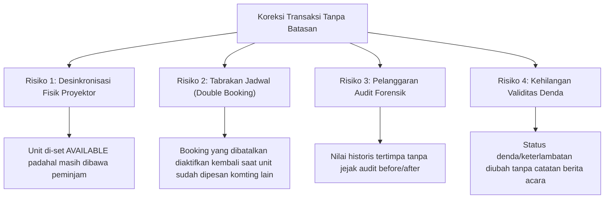

# LAPORAN INVESTIGASI UAT — KOREKSI TRANSAKSI ADMIN
**Branch:** `feat/fullstack-integration`  
**Target Database:** `PINJAM_TESTING` (`kaflptksvqwcurzacifs.supabase.co`)  
**Status Modul:** **MENUNGGU FINALISASI KONTRAK (COMING SOON / OPEN DECISION)**  
**Waktu Investigasi:** 27 November 2026, 22:07 WIB  
**Metode:** Read-Only Codebase & Contract Inspection (Tanpa Mutasi Data)

---

## 1. RINGKASAN EKSEKUTIF

Investigasi mendalam dilakukan terhadap fitur **Koreksi Transaksi ADMIN** pada branch `feat/fullstack-integration`. Berdasarkan penelusuran frontend, backend, RPC database, PRD (`PRD_PINJAM_FINAL.md`), dan spesifikasi kontrak (`API_CONTRACT_PINJAM.md`), ditemukan bahwa:

1. **Status Implementasi:**
   Halaman `/admin/corrections` saat ini berada dalam status **`SEGERA (COMING SOON)`** dan sengaja dinonaktifkan dengan tampilan panduan formal (`EmptyState` + `Alert`). Modul ini menunggu keputusan resmi mengenai daftar field yang diizinkan untuk dikoreksi (*Open Decision* §20/§23).
2. **Endpoint Backend:**
   Endpoint `POST /api/v1/admin/transactions/{transaction_id}/corrections` baru didefinisikan sebagai **kerangka kontrak** pada `API_CONTRACT_PINJAM.md` §13.3 dan **belum memiliki route handler / file controller** di direktori `src/app/api/v1/admin/transactions/`.
3. **Kesiapan Pengujian UAT:**
   Karena modul backend belum aktif dan form input belum dibuka, **tidak ada transaksi riil yang dapat dikoreksi melalui modul ini pada tahap sekarang**. Seluruh database `PINJAM_TESTING` tetap aman dan terlindungi dari manipulasi data sepihak.

---

## 2. PEMERIKSAAN KOMPONEN FRONTEND & BACKEND

### 2.1. Navigasi & Shell Admin
- **File:** `src/components/layout/admin-shell.tsx` baris 18:
  ```ts
  { label: "Koreksi Transaksi", href: "/admin/corrections", badge: "Segera" }
  ```
  Navigasi di sidebar secara transparan menampilkan badge `"Segera"` untuk memberi tahu ADMIN bahwa fitur ini belum masuk ke fase rilis penuh.

### 2.2. Halaman Frontend (`/admin/corrections`)
- **File:** `src/app/admin/corrections/page.tsx`:
  - **Otorisasi Frontend:** Dilindungi oleh `<RoleGuard allowedRoles={["ADMIN"]}>`. Pengguna role STAFF atau KOMTING ditolak dan dialihkan ke `/forbidden`.
  - **Banner Peringatan:** Menjelaskan status kontrak:
    > *"Status Kontrak §13.3 & Open Decision §20: `POST /api/v1/admin/transactions/{transaction_id}/corrections` baru berstatus kerangka kontrak di API_CONTRACT_PINJAM.md. Sesuai kebijakan proyek, form koreksi belum diaktifkan sebelum daftar field yang boleh dikoreksi disepakati secara eksplisit oleh backend dan PRD."*
  - **EmptyState:** Menyediakan tautan penelusuran langsung ke `/admin/audit-logs` dan `/admin`.

### 2.3. Service & API Client Frontend
- **File:** `src/services/contracts.ts` baris 277–284:
  ```ts
  export interface AdminService {
    correctTransaction(
      transactionId: string,
      payload: {
        reason: string;
        correction: { field: string; new_value: unknown };
      }
    ): Promise<ApiSingleResponse<ApiActionResult>>;
  }
  ```
- **File:** `src/services/api/api-services.ts` baris 215–219:
  ```ts
  correctTransaction: (transactionId, payload) =>
    apiRequest(`/admin/transactions/${encodeURIComponent(transactionId)}/corrections`, {
      method: "POST",
      body: payload,
    }),
  ```
- **File:** `src/services/mock/mock-services.ts` baris 1711–1714:
  Pada simulasi dev mock, endpoint ini hanya merespons dummy `{ success: true }`.

### 2.4. Arsitektur Backend & Database
- Direktori `src/app/api/v1/admin/transactions` **belum dibuat**.
- Pada folder migrasi `supabase/migrations/` (migrasi 001–017), **tidak ditemukan fungsi RPC atau trigger khusus bernama `rpc_admin_correct_transaction`**.
- Seluruh mutasi transaksi saat ini dikelola oleh RPC atomik spesifik per domain:
  - `rpc_komting_create_booking` & `rpc_komting_cancel_booking`
  - `rpc_staff_confirm_pickup` (transisi booking ke loan + status proyektor `BORROWED`)
  - `rpc_staff_confirm_return` (transisi loan ke returned + evaluasi kondisi unit)
  - `rpc_admin_upsert_operating_hours`
  - `rpc_staff_start_maintenance` & `rpc_staff_complete_maintenance`

---

## 3. ATURAN BISNIS & SPESIFIKASI PRD (TERKAIT KOREKSI)

Berdasarkan `PRD_PINJAM_FINAL.md` §7.8, §7.15, §11 (FR-028), dan §22.1:

1. **Hak Eksklusif ADMIN:**
   STAFF dan KOMTING dilarang keras mengubah atau menghapus transaksi selesai secara diam-diam. Koreksi hanya boleh dieksekusi oleh ADMIN.
2. **Alasan Wajib (*Mandatory Reason*):**
   Setiap koreksi wajib menyertakan alasan yang jelas (`reason: string`, non-empty).
3. **Kekekalan Jejak Audit (*Immutable Audit Log*):**
   - Koreksi **TIDAK BOLEH** menghapus atau menimpa rekaman audit log asli.
   - Setiap koreksi harus menghasilkan rekaman audit baru yang memuat:
     - `actor_user_id` & `actor_role: 'ADMIN'`
     - `action: 'TRANSACTION_CORRECTED'`
     - `before_data` (nilai lama sebelum dikoreksi)
     - `after_data` (nilai baru setelah koreksi)
     - `reason` (alasan koreksi)
     - `request_id` (korelasi penelusuran)
4. **Validasi Ulang Aturan Bisnis (*No Business Rule Bypass*):**
   Koreksi tidak boleh menjadi celah jalan pintas (*backdoor*) untuk melewati aturan domain, seperti:
   - Mengubah status proyektor menjadi `AVAILABLE` padahal unit fisik masih dalam status pinjaman aktif (`BORROWED`).
   - Membuat jadwal booking yang tumpang tindih (*overlap*) pada unit yang sama.
   - Menghapus histori transaksi peminjaman.

---

## 4. ANALISIS RISIKO INTEGRITAS DATA

Jika form dan endpoint koreksi dibuka secara bebas tanpa whitelist field dan validasi atomik, terdapat 4 risiko kritis:



### Rincian Risiko:
1. **Status Fisik Proyektor:**
   Tabel `public.projectors` memiliki kolom `physical_status` (`AVAILABLE`, `BORROWED`, `MAINTENANCE`, `INACTIVE`). Transisi status ini dikunci secara atomik dengan `pg_advisory_xact_lock` pada RPC pickup dan return. Koreksi manual yang mengubah status unit tanpa menutup baris `loans` akan merusak state machine sistem.
2. **Konsistensi Relasi Booking & Loan:**
   Hubungan antara `bookings` (status `CONFIRMED`, `CANCELLED`, `EXPIRED`, `COMPLETED`) dan `loans` (status `ACTIVE`, `RETURNED`) terikat satu-ke-satu. Koreksi yang mencoba mengubah `booking_date` atau `projector_id` pada loan yang sedang berjalan akan memicu anomali ketersediaan jadwal.
3. **Pemberian Toleransi Pickup Keterlambatan (PRD §7.8 point 5):**
   PRD menyatakan: *"Pengambilan setelah batas toleransi hanya dapat dilakukan melalui koreksi/otorisasi ADMIN yang tercatat."* Fitur ini memerlukan otorisasi eksplisit per booking ID untuk memperpanjang batas `pickup_window_end_at`, bukan koreksi bebas terhadap kolom database.

---

## 5. REKOMENDASI WHITELIST FIELD KOREKSI (PENUTUPAN OPEN DECISION)

Berdasarkan analisis risiko di atas, berikut adalah rekomendasi field yang **BOLEH** dan **TIDAK BOLEH** dikoreksi jika backend endpoint `/admin/transactions/{id}/corrections` diimplementasikan di masa mendatang:

| Kategori Field | Field | Status | Batasan & Aturan Validasi |
|---|---|---|---|
| **Pickup Detail** | `representative_name` | **DIIZINKAN** | Hanya jika terjadi salah catat nama wakil komting saat pengambilan. |
| **Pickup Detail** | `note` (catatan pickup) | **DIIZINKAN** | Menambahkan catatan operasional pickup. |
| **Jendela Pickup** | `pickup_window_end_at` | **DIIZINKAN BERSYARAT** | Hanya jika booking `EXPIRED` karena keterlambatan komting dan unit masih `AVAILABLE` pada hari yang sama (PRD §7.8.5). |
| **Return Detail** | `return_condition_note` | **DIIZINKAN** | Koreksi catatan deskriptif kondisi unit proyektor. |
| **Identitas Inti** | `booking_id`, `loan_id` | **DILARANG KERAS** | Primary key bersifat *immutable*. |
| **Aktor Transaksi** | `komting_id`, `created_by` | **DILARANG KERAS** | Peminjam tidak boleh dipindahtangankan pasca transaksi. |
| **Unit Proyektor** | `projector_id` | **DILARANG KERAS** | Mengganti unit pada booking aktif harus melalui alur pembatalan & re-booking resmi. |
| **Status Mesin** | `physical_status` | **DILARANG KERAS** | Status fisik unit hanya boleh berubah lewat RPC resmi (`pickup`, `return`, `maintenance`). |

---

## 6. RANCANGAN SKENARIO UAT (JIKA MODUL SUDAH DIAKTIFKAN)

Jika di masa mendatang tim pengembang mengaktifkan backend endpoint koreksi ini, berikut skenario pengujian aman yang direkomendasikan:

1. **TC-CORR-01 (Koreksi Catatan Transaksi):**
   ADMIN mengoreksi catatan penyerahan barang dengan alasan valid &rarr; Status 200 OK, rekaman audit baru tercatat.
2. **TC-CORR-02 (Koreksi Nama Perwakilan):**
   ADMIN mengoreksi nama perwakilan komting yang salah eja &rarr; Kolom `representative_name` terbarui, data lama tersimpan di `before_data`.
3. **TC-CORR-03 (Penolakan Koreksi Tanpa Alasan):**
   ADMIN mengirimkan request dengan `reason: ""` &rarr; Ditolak dengan `422 Unprocessable Entity` / `INVALID_REQUEST`.
4. **TC-CORR-04 (Penolakan Role Non-Admin):**
   STAFF dan KOMTING mencoba memanggil endpoint koreksi &rarr; Ditolak dengan `403 FORBIDDEN`.
5. **TC-CORR-05 (Penolakan Koreksi Field Ilegal):**
   ADMIN mencoba mengoreksi `projector_id` atau `physical_status` &rarr; Ditolak dengan `400 FIELD_NOT_CORRECTABLE`.
6. **TC-CORR-06 (Idempotensi & Pencegahan Koreksi Ganda):**
   Pengiriman request dengan header `Idempotency-Key` yang sama &rarr; Tidak menduplikasi log audit.

---

## 7. KESIMPULAN KESIAPAN PENGUJIAN

1. **Status Fitur:**
   Modul Koreksi Transaksi ADMIN di `/admin/corrections` **BELUM SIAP DIUJI SECARA FUNGSIONAL TRANSAKSIONAL** karena backend endpoint `POST /api/v1/admin/transactions/{transaction_id}/corrections` belum diimplementasikan dan daftar field masih berstatus *Open Decision* di PRD/API Contract.
2. **Kesesuaian Frontend:**
   Halaman frontend `/admin/corrections` telah mengimplementasikan penanganan yang **sangat baik dan aman**: menampilkan status badge `SEGERA`, mengunci form agar tidak terjadi mutasi liar, serta mengarahkan admin ke Audit Log Sistem.
3. **Integritas Database:**
   Database `PINJAM_TESTING` tetap aman, bersih, dan tidak mengalami mutasi selama investigasi ini.
4. **Langkah Berikutnya:**
   Menunggu arahan/persetujuan pengguna terkait apakah fitur koreksi transaksi ini akan tetap dipertahankan sebagai modul *Coming Soon*, atau jika ingin disepakati spesifikasi dan diimplementasikan endpoint-nya.
