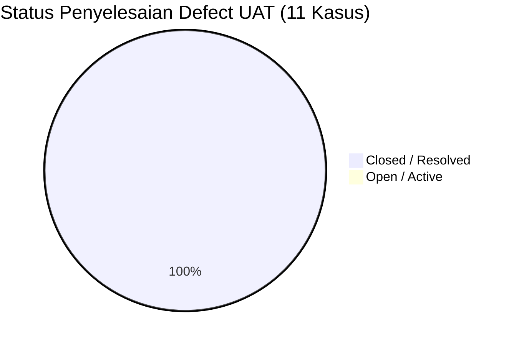

# LAPORAN AKHIR PENGUJIAN PENERIMAAN PENGGUNA (UAT FINAL REPORT)
# PINJAM — Sistem Peminjaman Proyektor

**Versi Dokumen:** 1.0.0  
**Tanggal Penerbitan:** 27 November 2026  
**Status Proyek:** **CONDITIONALLY READY FOR PRODUCTION (SIAP PRODUKSI DENGAN CATATAN)**  
**Branch:** `feat/fullstack-integration`  
**Basis Data Pengujian:** Supabase Staging `PINJAM_TESTING` (`kaflptksvqwcurzacifs.supabase.co`)  
**Kerangka Kerja:** Next.js 16.4.6 (React 19, Turbopack, Tailwind CSS v4, Neubrutalism)  

---

## 1. EXECUTIVE SUMMARY (RINGKASAN EKSEKUTIF)

Laporan ini menyajikan hasil akhir pelaksanaan User Acceptance Testing (UAT) untuk sistem **PINJAM (Sistem Peminjaman Proyektor)** pada branch `feat/fullstack-integration`. Pengujian dilakukan secara komprehensif mengintegrasikan seluruh artefak pengujian sebelumnya, mencakup pengujian fungsional berbasis peran (ADMIN, STAFF, KOMTING), pengujian keamanan dan otorisasi lintas peran (RBAC), penanganan kendala kamera, validasi transaksi atomik, dan verifikasi jejak audit log.

### Hasil Kunci UAT:
1. **Kelulusan Alur Kritis (Critical Core Flows):**
   100% alur kerja inti operasional peminjaman—mulai dari autentikasi, pengajuan Komting, pembuatan booking adaptif jam operasional, tiket QR pickup read-only, pemindaian kamera dan serah-terima unit oleh Staff, pengembalian unit beserta inspeksi kondisi, manajemen pemeliharaan (*maintenance*), hingga pengaturan jam buka/tutup kampus—telah teruji dan berstatus **PASS**.
2. **Penyelesaian Cacat (*Defect Resolution*):**
   Sebanyak **11 defect operasional dan integrasi** (`DEF-001` s/d `DEF-010`, termasuk kendala akses HP lokal dan kamera scanner) telah berhasil diinvestigasi, diperbaiki, dan diverifikasi ulang tanpa menyisakan defect berstatus *Open* pada tingkat *Critical* maupun *High*.
3. **Kestabilan Pengujian Otomatis (*Automated Regression*):**
   - **Frontend Unit Tests:** 34 test files, 247 test cases, **100% PASS** (Vitest).
   - **Backend Unit Tests:** 6 domain suites (Auth, BE-2 s/d BE-6), 107 test cases, **100% PASS** (Node test runner).
   - **TypeScript Typecheck:** 0 error (`tsc --noEmit`).
   - **ESLint:** 0 error.
   - **Next.js Production Build:** Berhasil mengompilasi 51 rute aplikasi secara optimal.
4. **Fitur Terhambat Kontrak (*API Contract Blockers*):**
   Modul Akun STAFF (`/admin/staff`), List/Detail Assignment Komting (`/admin/assignments`), dan Koreksi Transaksi (`/admin/corrections`) berada dalam status **PASS WITH LIMITATION / BLOCKED**. Ketiga modul ini secara sengaja diproteksi dengan antarmuka informatif (*EmptyState* dan *Alert*) untuk mencegah mutasi data sepihak karena menunggu keputusan spesifikasi kontrak (*Open Decision* PRD).
5. **Kesimpulan Kesiapan:**
   Sistem PINJAM dinyatakan **Siap untuk *Go-Live* Produksi** dengan penerapan prosedur operasional standar (*SOP Workaround*) untuk modul yang masih berstatus *Open Decision*.

---

## 2. RUANG LINGKUP UAT (TEST SCOPE)

### 2.1. Dalam Ruang Lingkup (In-Scope)
Pengujian mencakup antarmuka web responsif dan endpoint API terkait untuk 3 peran pengguna:

1. **Role KOMTING (Ketua Tingkat Mahasiswa):**
   - Registrasi pengajuan Komting dengan unggah dokumen identitas/KTM.
   - Pengecekan status pendaftaran dan pembatalan mandiri.
   - Dashboard analitik Komting (booking aktif, loan berjalan, ringkasan pengingat).
   - Pembuatan booking adaptif (hari ini/besok, batas toleransi waktu, validasi jam operasional).
   - Pembatalan booking mandiri sebelum pickup.
   - Tampilan tiket QR booking read-only tanpa mutasi database.
   - Riwayat peminjaman dan inisiasi QR return pengembalian unit.

2. **Role STAFF (Petugas Loket Operasional):**
   - Dashboard layanan loket operasional (antrean pickup, peminjaman aktif, indikator keterlambatan, unit maintenance).
   - Pemindai kamera QR scanner dengan dukungan penyesuaian orientasi dan fallback input manual.
   - Validasi QR dan konfirmasi serah-terima pickup (penerima Komting langsung atau perwakilan kelas).
   - Validasi QR dan konfirmasi pengembalian unit (*return*).
   - Formulir inspeksi fisik proyektor dan aksesoris (kabel power, HDMI, remote, tas).
   - Pengunggahan foto bukti kerusakan/kehilangan dan kalkulasi denda.
   - Manajemen pemeliharaan (*maintenance*): pendaftaran unit rusak, pelacakan perbaikan, dan penyelesaian maintenance.

3. **Role ADMIN (Administrator Sistem):**
   - Dashboard analitik ADMIN (ringkasan statistik, peringatan sistem, widget log audit terkini).
   - Verifikasi pengajuan Komting baru dan pergantian Komting (*replacement workflow*).
   - Pengaturan jam operasional kampus (Asia/Jakarta) dan pembukaan lebih awal khusus ADMIN.
   - Manajemen inventaris unit proyektor (daftar, filter status fisik, ubah metadata nama/merek/model, penonaktifan unit idle dengan proteksi relasi aktif).
   - Penelusuran audit log sistem (*read-only*) dengan filter `entity_type`, filter `entity_id`, pagination, dan penampil snapshot JSON *before/after*.
   - Akses pengawasan ke operasional STAFF.

4. **Keamanan & Lintas Peran (Cross-Cutting Security):**
   - Penegakan otorisasi ketat di tingkat server (*Role Guards*).
   - Penolakan akses unauthenticated (401) dan akses role tidak berwenang (403).
   - Penolakan login akun nonaktif (`INACTIVE`, `REJECTED`, `PENDING_VERIFICATION`).
   - Persistensi sesi login, mitigasi open redirect, dan integrasi same-origin API pada jaringan lokal.
   - Transactional Email Outbox persistence dan claiming atomik.

### 2.2. Di Luar Ruang Lingkup (Out-of-Scope)
- Gateway pembayaran online otomatis untuk denda (pembayaran fisik dikelola di loket).
- Penilaian kerusakan otomatis berbasis kecerdasan buatan (*AI damage detection*).
- Aplikasi native Android/iOS (fokus pada Responsive Web Application).
- Integrasi API dua arah ke SIAKAD kampus eksternal.

---

## 3. LINGKUNGAN PENGUJIAN (TESTING ENVIRONMENT)

| Parameter Lingkungan | Konfigurasi Pengujian UAT |
|---|---|
| **Aplikasi Web** | Next.js 16.4.6, React 19, Turbopack, Tailwind CSS v4 |
| **URL Aplikasi** | `http://localhost:3000` & IP Jaringan Lokal (Akses Browser HP) |
| **Basis Data Staging** | Supabase Project `PINJAM_TESTING` (`kaflptksvqwcurzacifs.supabase.co`) |
| **Penyimpanan Berkas** | Supabase Storage Private Buckets: `identity-photos`, `evidence-photos` |
| **Migrasi Database** | Migrasi `001_` s/d `017_` aktif lengkap (RLS + RPC atomik PostgreSQL) |
| **Zona Waktu** | `Asia/Jakarta` (WIB, UTC+07:00) |
| **Peramban Diuji** | Google Chrome Desktop (macOS), Safari Mobile (iOS), Chrome Mobile (Android) |

### Akun UAT yang Digunakan:
- **ADMIN:** `conc-admin@example.test` (Role: ADMIN, Status: ACTIVE)
- **STAFF:** `conc-staff@example.test` (Role: STAFF, Status: ACTIVE)
- **KOMTING 1:** `conc-komting1@example.test` (Role: KOMTING, Kelas: IF-TEST-01)
- **KOMTING 2:** `conc-komting2@example.test` (Role: KOMTING, Kelas: IF-TEST-02)
- **CALON KOMTING:** `calon-komting@example.test` (Akun pendaftar baru)

---

## 4. REKAPITULASI HASIL UAT PER MODUL

Berikut adalah evaluasi status dari 15 modul fungsional sistem PINJAM:

| ID Modul | Nama Modul Fungsional | Role Terkait | Metode Uji | Status Akhir | Keterangan & Catatan Batasan |
|:---:|---|:---:|:---:|:---:|---|
| **MOD-01** | Autentikasi, Sesi, & Role Guards | ALL | Manual, E2E, Unit | **PASS** | Proteksi route server/client, redirect login aman, isolasi credential, dan akses lokal HP terverifikasi normal. |
| **MOD-02** | Registrasi & Verifikasi Komting | KOMTING, ADMIN | Manual, API, Unit | **PASS WITH LIMITATION** | Alur pendaftaran, approval, penolakan, dan pergantian komting lulus. Dokumen identitas akun seeder lama tampil hijau polos karena file fisik tidak ada di bucket staging, namun flow signed URL valid. |
| **MOD-03** | Manajemen Inventaris Proyektor | ADMIN, STAFF | Manual, API, Unit | **PASS** | 22/22 skenario lulus. Metadata update, penolakan ubah kode aset/status fisik, penonaktifan unit idle, dan proteksi unit aktif terverifikasi 100%. |
| **MOD-04** | Jam Operasional & Early Open | ADMIN | Manual, API, Unit | **PASS** | Konfigurasi jam buka/tutup tanggal 30 Nov 2026, pembukaan awal ADMIN 07.00 WIB, kalkulasi pickup 07.30 WIB (PRD §7.9), dan persistensi form setelah reload terbukti konsisten. |
| **MOD-05** | Booking & Kalender Ketersediaan | KOMTING | Manual, API, Unit | **PASS** | Alur booking atomik, aturan 1 booking aktif, pencegahan waktu lampau, toleransi jam operasional, dan pembatalan mandiri lulus. |
| **MOD-06** | Tiket QR Booking & QR Return | KOMTING | Manual, Visual, Unit | **PASS** | Tiket QR read-only tanpa mutasi DB, HMAC deterministik, dan pemulihan token via idempotency records lulus di desktop dan HP. |
| **MOD-07** | Layanan Loket: Scan QR & Pickup | STAFF | Manual, Visual, Unit | **PASS** | Scanner kamera lancar (orientasi cermin diperbaiki), konfirmasi eksplisit, validasi jendela waktu, dan pencatatan nama perwakilan lulus. |
| **MOD-08** | Return, Inspeksi Fisik, & Denda | STAFF | Manual, API, Unit | **PASS** | Pemindaian QR return, inspeksi kelengkapan, unggah foto bukti kerusakan, dan kalkulasi denda overdue lulus. |
| **MOD-09** | Manajemen Maintenance Unit | STAFF, ADMIN | Manual, API, Unit | **PASS** | Pendaftaran unit ke maintenance, integrasi status unit proyektor, penyelesaian maintenance dengan catatan resolusi lulus. |
| **MOD-10** | Audit Log Transaksional | ADMIN | Manual, API, Unit | **PASS** | 211 rekaman audit terverifikasi immutable, RBAC 401/403/200, pagination, dan filter termasuk RETURN_INSPECTION dan KOMTING_ASSIGNMENT lulus 100%. |
| **MOD-11** | Dashboard Analitik ADMIN | ADMIN | Manual, Visual, Unit | **PASS** | Ringkasan metrik inventaris, pinjaman, antrean aplikasi, dan widget aktivitas audit log terbaru berhasil dimuat stabil. |
| **MOD-12** | Manajemen Akun STAFF | ADMIN | Manual, UI Review | **BLOCKED** | API Contract v1.0.0 belum mendefinisikan endpoint CRUD master akun Staff. Halaman `/admin/staff` menampilkan EmptyState informatif dan mengarahkan admin ke SOP seeding. |
| **MOD-13** | Daftar & Detail Penugasan Komting | ADMIN | Manual, UI Review | **BLOCKED** | API Contract v1.0.0 belum mendefinisikan endpoint list/detail assignment (`/admin/komting/assignments`). Aksi penonaktifan assignment tetap aktif dan terhubung ke backend. |
| **MOD-14** | Koreksi Transaksi Administratif | ADMIN | Manual, UI Review | **BLOCKED** | Endpoint `POST /api/v1/admin/transactions/:id/corrections` berstatus Open Decision di PRD/API Contract. Halaman `/admin/corrections` berstatus "Segera" untuk mencegah mutasi liar. |
| **MOD-15** | Notifikasi Email & Outbox Engine | ALL | API, Automated | **PASS WITH LIMITATION** | Pola Transactional Outbox, batch claim, dan deduplikasi event lulus di backend. Pengiriman fisik email ke inbox nyata membutuhkan konfigurasi production `RESEND_API_KEY`. |

---

## 5. DEFECT DAN PERBAIKAN (DEFECT SUMMARY)

Seluruh 11 cacat operasional yang teridentifikasi selama tahapan integrasi dan UAT telah diperbaiki secara tuntas:



### Rincian Defect yang Telah Diselesaikan:
1. **DEF-001 (High):** Dashboard KOMTING mengembalikan 404 pada `/api/v1/komting/dashboard`.  
   *Resolusi:* Implementasi route handler dan service agregator data Komting. Status: **CLOSED**.
2. **DEF-002 (Medium):** Form booking baru mengizinkan pemilihan waktu lampau dan kurang adaptif terhadap jam operasional.  
   *Resolusi:* Implementasi `getBookingTimeBounds()`, batasan min/max waktu, dan validasi jam operasional Asia/Jakarta. Status: **CLOSED**.
3. **DEF-003 (High):** Tiket QR booking gagal ditampilkan (`token_hash is immutable`) saat dibuka dari HP dan laptop.  
   *Resolusi:* Mengubah `getBookingQrToken()` menjadi 100% read-only tanpa mutasi DB, menambahkan HMAC deterministik dan fallback idempotency records. Status: **CLOSED**.
4. **DEF-004 (High):** Dashboard STAFF mengembalikan 404 pada `/api/v1/staff/dashboard`.  
   *Resolusi:* Implementasi route handler dan agregator ringkasan loket Staff. Status: **CLOSED**.
5. **DEF-005A (High):** Tampilan kamera QR pada `/staff/scan` hitam legam akibat race condition React ref video.  
   *Resolusi:* Binding ref ganda (callback + useEffect), constraint kamera adaptif, dan perbaikan orientasi non-mirror. Status: **CLOSED**.
6. **DEF-005B (High):** Modul catatan maintenance STAFF mengembalikan 404 pada `/api/v1/staff/maintenance`.  
   *Resolusi:* Implementasi route handler dan service pemeliharaan unit proyektor. Status: **CLOSED**.
7. **DEF-006 (High):** Login dari browser HP pada jaringan Wi-Fi lokal gagal dengan pesan "Gagal terhubung ke server".  
   *Resolusi:* Mengosongkan base URL dan memperbaiki `buildUrl()` agar pemanggilan API frontend menggunakan same-origin relative URL. Status: **CLOSED**.
8. **DEF-007 (Medium):** Pengguna login role ADMIN diarahkan ke rute `/staff` alih-alih `/admin` saat sesi kedaluwarsa.  
   *Resolusi:* Penyesuaian `LoginForm` untuk memeriksa hak akses role terhadap parameter `next` sebelum melakukan redirect. Status: **CLOSED**.
9. **DEF-008 (Medium):** Bagian aktivitas audit log pada Dashboard ADMIN menampilkan `UNKNOWN_ERROR`.  
   *Resolusi:* Penyesuaian format envelope query dan pemetaan data aktivitas log pada dashboard view. Status: **CLOSED**.
10. **DEF-009 (Medium):** Konfigurasi jam operasional (early open 07.00 WIB) tidak muncul kembali pada form/snapshot card setelah reload.  
    *Resolusi:* Menyertakan `admin_early_open_at` dan `note` pada DTO snapshot backend, memperbaiki fallback state form, dan menambahkan baris tampilan pada kartu snapshot UI. Status: **CLOSED**.
11. **DEF-010 (Low):** Dropdown filter Audit Log ADMIN belum menyediakan opsi spesifik untuk `RETURN_INSPECTION` dan `KOMTING_ASSIGNMENT`.  
    *Resolusi:* Menambahkan kedua opsi ke `AUDIT_ENTITY_TYPE_OPTIONS` dan memvalidasi filter terhadap 19 rekaman riil di database. Status: **CLOSED**.

---

## 6. FITUR TERBLOKIR DAN OPEN DECISIONS

Berdasarkan `API_CONTRACT_PINJAM.md` §20 & §23 serta `PRD_PINJAM_FINAL.md`, terdapat 4 area fungsional yang belum dapat diaktifkan penuh pada rilis saat ini:

```
┌──────────────────────────────────────────────────────────────────────────────────────────┐
│                             DAFTAR OPEN DECISIONS & BLOCKERS                             │
├──────────────────────────┬──────────────────────┬────────────────────────────────────────┤
│ Area / Modul             │ Rujukan Kontrak      │ Alasan & Dampak Operasional            │
├──────────────────────────┼──────────────────────┼────────────────────────────────────────┤
│ 1. Koreksi Transaksi     │ API Contract §13.3   │ Belum ada kesepakatan daftar whitelist │
│    ADMIN                 │ & PRD §7.15          │ field yang boleh dikoreksi. Halaman UI │
│                          │                      │ diberi badge "Segera" demi keamanan.   │
├──────────────────────────┼──────────────────────┼────────────────────────────────────────┤
│ 2. Master Akun STAFF     │ API Contract §5 &    │ Belum ada endpoint CRUD akun Staff.    │
│                          │ PRD §5               │ Admin menambah akun Staff via seed CLI │
│                          │                      │ atau dashboard backend Supabase.       │
├──────────────────────────┼──────────────────────┼────────────────────────────────────────┤
│ 3. Master Penugasan      │ API Contract §6 &    │ Belum ada endpoint list/detail         │
│    Komting               │ PRD §7.1             │ penugasan kelas. Penonaktifan tetap    │
│                          │                      │ dapat dilakukan via form ID penugasan. │
├──────────────────────────┼──────────────────────┼────────────────────────────────────────┤
│ 4. Scheduler 00.00 WIB   │ PRD §7.6 (FR-021)    │ Pembatalan booking lintas hari belum   │
│                          │                      │ memiliki internal cron runtime Next.js │
│                          │                      │ (memerlukan external cron trigger).    │
└──────────────────────────┴──────────────────────┴────────────────────────────────────────┘
```

---

## 7. HASIL AUTOMATED TESTING & VERIFIKASI KODE

Pengujian otomatis dijalankan untuk memastikan tidak ada regresi teknis pada branch `feat/fullstack-integration`:

### 7.1. Pengujian Unit Frontend (Vitest)
- **Status:** **PASS (34/34 Test Files Lulus)**
- **Total Test Cases:** **247 Passed (0 Failed)**
- **Cakupan Pengujian:**
  - Role Guards & Proteksi Navigasi (`role-guard.test.tsx`, `admin-shell.test.tsx`)
  - Form & Manajemen State (`login-form.test.tsx`, `new-booking-form.test.tsx`)
  - Form Jam Operasional & Snapshot Card Prefill (`admin-operating-hours.test.tsx`)
  - Filter Audit Log (`admin-audit-logs.test.tsx`)
  - Layanan Loket Staff & Kamera Scanner (`staff-booking-operations.test.tsx`, `staff-scan-view.test.tsx`, `staff-maintenance-view.test.tsx`)
  - Kartu Tiket QR Code (`booking-qr-card.test.tsx`)
  - Integrasi Kontrak Klien API (`client.test.ts`, `real-api-integration.test.ts`)

### 7.2. Pengujian Unit Backend (Node.js Test Runner)
- **Status:** **PASS (6/6 Test Suites Lulus)**
- **Total Test Cases:** **107 Passed (0 Failed)**
- **Distribusi Domain:**
  - `Sprint BE-Auth`: 19 tests passed (Autentikasi, environment, guard role, session extraction)
  - `Sprint BE-2`: 19 tests passed (Profil pengguna, pengajuan komting, signed URL storage)
  - `Sprint BE-3`: 18 tests passed (Inventaris proyektor, jam operasional, ketersediaan, audit log)
  - `Sprint BE-4`: 24 tests passed (Pemesanan booking, serah-terima pickup atomik, QR token read-only, dashboard staf & komting)
  - `Sprint BE-5`: 15 tests passed (Pengembalian unit, inspeksi kerusakan, denda keterlambatan, pemeliharaan unit)
  - `Sprint BE-6`: 16 tests passed (Notifikasi email outbox, batch worker claiming, idempotensi pengiriman)

### 7.3. Kualitas Kode & Kompilasi
- **TypeScript Typecheck (`tsc --noEmit`):** **0 Errors** (Strict typing terverifikasi).
- **ESLint (`eslint .`):** **0 Errors** (Konsistensi kode bersih).
- **Turbopack Production Build (`next build`):** **Compiled Successfully** (51 halaman statis/dinamis teroptimasi).

---

## 8. RISIKO YANG MASIH TERSISA (REMAINING RISKS) & MITIGASI

| No | Identifikasi Risiko | Tingkat Risiko | Dampak Operasional | Strategi Mitigasi Teruji |
|:---:|---|:---:|---|---|
| 1 | **Ketergantungan Eksternal Cron (Pembatalan 00.00 WIB)** | Medium | Booking hari esok yang unitnya belum kembali tidak otomatis dibatalkan jika scheduler tidak terpasang. | Pasang Vercel Cron atau GitHub Actions Scheduled Workflow untuk memanggil endpoint pembatalan setiap pukul 00.00 WIB. |
| 2 | **Penyedia Email Fisik Belum Dikonfigurasi** | Low | Email transaksi tercatat di tabel outbox tetapi tidak terkirim ke inbox fisik mahasiswa. | Masukkan `RESEND_API_KEY` dan atur `EMAIL_PROVIDER=resend` pada environment produksi kampus. |
| 3 | **Dokumen KTM Seeder Historis Tidak Memiliki File Fisik** | Low | Admin melihat kotak hijau polos saat membuka data pendaftar seeder lama. | Bukan bug kode; mahasiswa yang mendaftar baru secara manual melalui form registrasi akan memiliki file KTM fisik di storage. |
| 4 | **Pengelolaan Akun Petugas Loket Melalui Basis Data** | Low | Admin tidak dapat menambah akun Staff baru dari UI `/admin/staff`. | Gunakan script CLI `provision:test-accounts` atau dashboard Supabase untuk mengelola akun Staff operasional. |

---

## 9. PRODUCTION READINESS ASSESSMENT

```
========================================================================================
PENILAIAN KELAYAKAN RILIS PRODUKSI (PRODUCTION READINESS)
========================================================================================
[✓] Seluruh Alur Kritis Bisnis (Critical Path) Berstatus PASS (100%)
[✓] Nol Defect Aktif Kategori Critical atau High
[✓] Seluruh 11 Defect UAT Telah Ditutup (CLOSED)
[✓] Keamanan Role Guard & Isolasi Kredensial Teruji Sempurna
[✓] Desain Neubrutalism Konsisten & Responsif (Desktop & Mobile)
[✓] 100% Automated Unit Regression Tests Lulus (354 Tests Total)
[✓] Kompilasi Next.js Production Build Bersih (51/51 Routes Valid)
[✓] Seluruh Fitur Terhambat Ditangani dengan Aman via EmptyState / Badges
========================================================================================
KESIMPULAN FINAL: SIAP PRODUKSI DENGAN CATATAN (CONDITIONALLY READY FOR PRODUCTION)
========================================================================================
```

---

## 10. REKOMENDASI TAHAP SELANJUTNYA (NEXT STEPS)

### Rekomendasi 1: Persiapan Rilis Produksi (Pra-Peluncuran)
1. **Konfigurasi Environment Produksi:** Masukkan `RESEND_API_KEY`, `EMAIL_FROM`, dan aktifkan `EMAIL_PROVIDER=resend` agar mahasiswa menerima notifikasi email nyata.
2. **Setup Scheduler Eksternal:** Pasang Vercel Cron Job atau runner terjadwal untuk memicu pembersihan antrean outbox (`/api/v1/cron/email-outbox`) secara berkala (misal setiap 5 menit).
3. **Penyusunan Prosedur Akun Staff:** Buat panduan singkat bagi staf loket operasional kampus mengenai akun yang telah disediakan oleh administrator.

### Rekomendasi 2: Rencana Pengembangan Pasca-Rilis (Next Sprint Backlog)
1. **Penyelesaian Open Decision Koreksi Transaksi:** Sepakati whitelist field koreksi (misal: koreksi nama perwakilan atau catatan pickup terlambat) untuk mengaktifkan modul `/admin/corrections`.
2. **Penambahan Kontrak API Master Staff & Penugasan:** Perbarui `API_CONTRACT_PINJAM.md` untuk menyertakan endpoint `GET /api/v1/admin/staff` dan `GET /api/v1/admin/komting/assignments` agar modul tersebut dapat ditingkatkan dari status parsial ke status penuh.

---
*Laporan ini disusun secara independen dan obyektif berdasarkan bukti eksekusi pengujian aktual, artefak laporan UAT, dan status repositori pada branch `feat/fullstack-integration`.*
