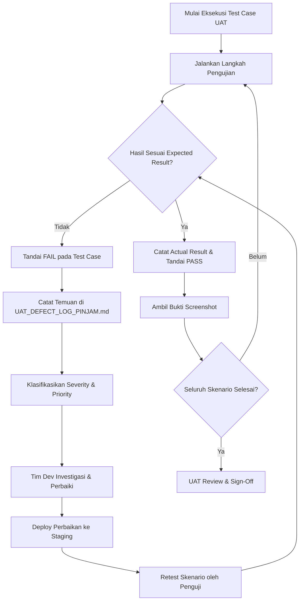

# RENCANA PENGUJIAN PENERIMAAN PENGGUNA (UAT PLAN)
# PINJAM — Sistem Peminjaman Proyektor

**Versi:** 1.0.0  
**Tanggal:** 27 November 2026  
**Status:** Draf Siap Uji (Ready for UAT Execution)  
**Branch:** `feat/fullstack-integration`  
**Target Rilis:** PINJAM Versi 1.0.0  

---

## 1. Pendahuluan

### 1.1 Latar Belakang
Aplikasi **PINJAM** adalah sistem informasi berbasis web untuk mengelola pendaftaran ketua tingkat (KOMTING), reservasi unit proyektor, serah-terima unit (pickup), pengembalian fisik (return & inspection), jam operasional, inventaris proyektor, pencatatan log audit transaksional, dan notifikasi email transaksional.

Setelah menyelesaikan tahapan:
- **BE-1 s/d BE-6 (Backend Foundation & Atomic Workflows)**
- **FE-1 s/d FE-11 (Frontend User Interface Neubrutalism)**
- **Fase 3: Priority Backend-Frontend Integration**
- **Fase 4: End-to-End Integration Testing (23/23 PASS, Live Supabase)**

Sistem kini memasuki **Fase 5: User Acceptance Testing (UAT)**. Pengujian ini bertujuan untuk memvalidasi bahwa sistem telah memenuhi seluruh kebutuhan fungsional dan aturan bisnis dari sudut pandang pemangku kepentingan (*stakeholders*) dan pengguna akhir (*end-users*) sebelum dirilis ke lingkungan produksi.

### 1.2 Tujuan UAT
1. Menguji kesesuaian alur kerja operasional aplikasi PINJAM terhadap aturan bisnis pada `PRD_PINJAM_FINAL.md`.
2. Memverifikasi pengalaman pengguna (*User Experience*) dan antarmuka Neubrutalism pada `FRONTEND_SPEC_PINJAM.md`.
3. Memastikan integritas data, keamanan role guard, dan pencegahan bentrok transaksi sesuai `BACKEND_SPEC_PINJAM.md` dan `BACKEND_HANDOFF_PINJAM.md`.
4. Menemukan, mendokumentasikan, dan mengklasifikasikan kesenjangan (*gaps*), kendala (*defects*), atau ketidaksesuaian implementasi sebelum *go-live*.
5. Menjadi dasar formal persetujuan penerimaan sistem oleh pemilik produk (*Product Owner*) dan pihak fakultas/kampus.

---

## 2. Ruang Lingkup Pengujian (Scope)

### 2.1 Dalam Ruang Lingkup (In-Scope)
Pengujian mencakup seluruh antarmuka dan interaksi pengguna berbasis web yang terbagi dalam 3 peran aktor:

1. **Role ADMIN:**
   - Autentikasi dan pengelolaan sesi Admin.
   - Dashboard analitik dan ringkasan statistik operasional.
   - Verifikasi pengajuan pendaftaran Komting baru (termasuk verifikasi foto KTM via private signed URL).
   - Penyetujuan (*approval*) dan penolakan (*rejection*) pengajuan Komting.
   - Penyetujuan pergantian Komting (*replacement workflow*).
   - Penonaktifan penugasan Komting aktif.
   - Manajemen inventaris unit proyektor (tambah, ubah data, aktivasi/deaktivasi unit).
   - Manajemen jam operasional kampus dan penyesuaian jam buka/tutup per tanggal.
   - Manajemen akun petugas Staff loket.
   - Penelusuran dan audit log transaksional (*append-only*).

2. **Role STAFF (Petugas Loket Operasional):**
   - Autentikasi dan dashboard layanan loket Staff.
   - Pemantauan antrean booking yang siap diambil hari ini.
   - Validasi tiket QR booking untuk pengambilan (*action: PICKUP*).
   - Konfirmasi serah-terima unit proyektor (*pickup handover*) baik oleh Komting maupun perwakilan kelas.
   - Pemantauan peminjaman berjalan (*active loans*) dan indikator keterlambatan (*overdue*).
   - Validasi tiket QR return untuk pengembalian (*action: RETURN*).
   - Pemeriksaan kondisi fisik proyektor dan kelengkapan aksesoris (kabel, remote, tas).
   - Pengunggahan foto bukti jika terjadi kerusakan/kehilangan komponen dan penetapan denda.
   - Konfirmasi pengembalian unit dan disposisi status proyektor (*AVAILABLE* atau *MAINTENANCE*).
   - Pemantauan unit yang sedang dalam pemeliharaan (*maintenance*).

3. **Role KOMTING (Ketua Kelas Mahasiswa):**
   - Formulir registrasi pendaftaran Komting dengan unggah foto identitas/KTM.
   - Pengecekan status pengajuan pendaftaran Komting.
   - Autentikasi dan dashboard Komting aktif.
   - Eksplorasi inventaris proyektor dan ketersediaan waktu (*availability calendar*).
   - Pembuatan booking proyektor (pilihan hari ini atau besok).
   - Penegakan aturan bisnis: batas 1 booking aktif, batas 1 pinjaman aktif, pencegahan booking saat unit dipinjam.
   - Pembatalan booking mandiri sebelum unit diambil petugas.
   - Penayangan tiket QR pickup pada halaman detail booking.
   - Transisi status booking menjadi `FULFILLED` dan penyembunyian tiket QR pickup yang sudah digunakan.
   - Pemantauan riwayat peminjaman (*loan history*).
   - Inisiasi tiket QR return interaktif melalui modal dialog saat ingin mengembalikan unit proyektor.

4. **Keamanan & Alur Lintas Peran (Cross-Cutting Security):**
   - Otorisasi berbasis peran (*Role-Based Access Control*).
   - Penolakan akses lintas peran (misal Komting membuka halaman Admin dialihkan ke `/forbidden`).
   - Penolakan akses pengguna tanpa autentikasi dialihkan ke `/login`.
   - Penolakan login akun dengan status `INACTIVE`, `REJECTED`, atau `PENDING_VERIFICATION`.
   - Persistensi sesi pengguna setelah refresh halaman browser.
   - Pembersihan sesi saat logout.
   - Penanganan error responsif (400, 401, 403, 404, 409, 422, 500) dengan pesan ramah pengguna.
   - Pengiriman dan persistensi event transactional email outbox.

### 2.2 Di Luar Ruang Lingkup (Out-of-Scope)
Sesuai PRD §3.1 dan batasan rilis awal:
- Integrasi gateway pembayaran denda otomatis (pembayaran denda fisik dikelola di luar aplikasi).
- Integrasi sistem sanksi akademik kampus otomatis.
- Pengenalan wajah (*Face Recognition*).
- Penilaian otomatis tingkat kerusakan proyektor berbasis AI.
- Aplikasi mobile native (Android/iOS) — UAT berfokus pada Responsive Web Application.
- Integrasi langsung ke Sistem Informasi Akademik (SIAKAD) eksternal.

---

## 3. Lingkungan Pengujian (Testing Environment)

Pengujian UAT dilaksanakan pada lingkungan *staging-like* yang terhubung ke database cloud Supabase pengujian:

| Parameter | Spesifikasi Lingkungan UAT |
|---|---|
| **Aplikasi Web** | Next.js 16.4.6 (React 19, Turbopack, Tailwind CSS v4) |
| **URL Aplikasi** | `http://localhost:3000` (atau URL staging hosting resmi) |
| **Database & Auth** | Supabase Project `PINJAM_TESTING` (`kaflptksvqwcurzacifs.supabase.co`) |
| **Penyimpanan Berkas** | Supabase Storage Private Buckets: `identity-photos`, `evidence-photos` |
| **Database Migrations** | Migration 001–017 aktif lengkap (termasuk RPC atomik dan RLS) |
| **Email Processing** | Transactional Email Outbox Processor (Mock / Console Provider) |
| **Browser yang Didukung** | Google Chrome (Desktop & Mobile view), Mozilla Firefox, Apple Safari |
| **Zona Waktu UAT** | `Asia/Jakarta` (WIB, UTC+07:00) |

### 3.1 Akun Pengguna Pengujian UAT (Test Accounts)

| Role | Email Akun UAT | Password Standar | Deskripsi Peruntukan |
|---|---|---|---|
| **ADMIN** | `conc-admin@example.test` | `TestPassword123!` | Pengujian verifikasi, approval komting, jam operasional, inventaris, audit |
| **STAFF** | `conc-staff@example.test` | `TestPassword123!` | Pengujian validasi QR pickup/return, serah-terima, inspeksi, maintenance |
| **KOMTING 1** | `conc-komting1@example.test` | `TestPassword123!` | Akun Komting aktif Kelas IF-TEST-01 |
| **KOMTING 2** | `conc-komting2@example.test` | `TestPassword123!` | Akun Komting aktif Kelas IF-TEST-02 |
| **PENDAFTAR** | `calon-komting@example.test` | `TestPassword123!` | Akun baru untuk pengujian alur registrasi & upload KTM |
| **INACTIVE** | `e2e-inactive@example.test` | `TestPassword123!` | Akun nonaktif untuk pengujian penolakan otentikasi |

> [!IMPORTANT]
> Seluruh password pengujian di atas dikonfigurasikan khusus pada project pengujian `PINJAM_TESTING` dan tidak boleh digunakan pada lingkungan produksi sesungguhnya.

---

## 4. Metodologi Pengujian & Kriteria Penerimaan

### 4.1 Metodologi UAT
Pengujian dilakukan dengan pendekatan **Black-Box Testing** dan **Scenario-Based Testing**:
1. Penguji (*tester*) menjalankan skenario uji mengikuti langkah-langkah yang tercantum pada dokumen `UAT_TEST_CASES_PINJAM.md`.
2. Penguji memverifikasi apakah antarmuka dan respons sistem sesuai dengan *Expected Result*.
3. Penguji mengambil tangkapan layar (*screenshot*) sebagai bukti eksekusi.
4. Setiap deviasi atau kendala dicatat pada dokumen `UAT_DEFECT_LOG_PINJAM.md`.

### 4.2 Kriteria Kelulusan Skenario (Pass/Fail Criteria)
- **PASS:** Sistem merespons tepat sesuai *Expected Result*, validasi data berjalan, UI Neubrutalism merender informasi yang tepat, dan mutasi data tercatat di database tanpa error.
- **FAIL:** Terjadi kegagalan fungsi, pesan error yang tidak sesuai, data tidak tersimpan, transaksi bentrok, atau tampilan rusak sehingga menghalangi penyelesaian tugas pengguna.
- **BLOCKED:** Skenario tidak dapat dijalankan karena ada skenario prasyarat sebelumnya yang mengalami *FAIL*.
- **NOT TESTED:** Skenario belum dieksekusi oleh penguji.

### 4.3 Kriteria Penerimaan Rilis Sistem (Release Acceptance Criteria)
Sistem PINJAM dinyatakan **diterima** dan siap rilis ke tahap produksi apabila:
1. **100%** Test Case kategori *Critical* (Autentikasi, Approval Komting, Booking Atomicity, QR Pickup, Return Inspection) berstatus **PASS**.
2. **Tidak ada defect aktif** dengan tingkat keparahan (*Severity*) **Critical** atau **High**.
3. Defect dengan tingkat keparahan **Medium** atau **Low** telah disepakati solusinya atau dijadwalkan untuk perbaikan pada rilis berikutnya (*Accepted Minor Gaps*).
4. Seluruh rute antarmuka (15 halaman utama) dapat diakses dengan respons visual yang stabil.
5. Dokumen *Sign-Off* telah ditandatangani oleh pemangku kepentingan.

---

## 5. Prosedur Pelaksanaan UAT & Siklus Defect

### 5.1 Siklus Hidup Defect
1. **New:** Defect baru dilaporkan oleh tester di `UAT_DEFECT_LOG_PINJAM.md`.
2. **Triaged:** Defect ditinjau bersama tim untuk konfirmasi validitas, severity, dan penanggung jawab perbaikan.
3. **In Progress:** Developer melakukan perbaikan kode atau konfigurasi.
4. **Ready for Retest:** Perbaikan selesai dan siap diuji ulang oleh tester UAT.
5. **Closed:** Pengujian ulang berhasil (PASS) dan defect ditutup.
6. **Deferred / Known Gap:** Isu disepakati untuk tidak dikerjakan pada rilis saat ini karena merupakan keterbatasan spesifikasi yang disengaja.

---

## 6. Matriks Distribusi Test Case UAT

| Domain Pengujian | Target Role | Jumlah Test Case | Dokumen Referensi |
|---|:---:|:---:|---|
| **Domain ADM:** Fitur & Kewenangan Administrator | ADMIN | 15 Skenario | `UAT-ADM-01` s/d `UAT-ADM-15` |
| **Domain STF:** Layanan Loket & Operasional Staff | STAFF | 12 Skenario | `UAT-STF-01` s/d `UAT-STF-12` |
| **Domain KMT:** Pendaftaran, Reservasi & Return Komting | KOMTING | 15 Skenario | `UAT-KMT-01` s/d `UAT-KMT-15` |
| **Domain SEC:** Autentikasi, Keamanan & Email Outbox | Lintas Peran | 6 Skenario | `UAT-SEC-01` s/d `UAT-SEC-06` |
| **TOTAL SKENARIO UAT** | **Semua Role** | **48 Test Cases** | `UAT_TEST_CASES_PINJAM.md` |

---

## 7. Batasan & Kesenjangan yang Diketahui (Known Gaps)

Penguji UAT wajib memperhatikan kesenjangan berikut agar tidak salah mengidentifikasikannya sebagai cacat sistem (*false defect*):

1. **Halaman Koreksi Transaksi Admin (`/admin/corrections`):**
   - Halaman ini sengaja menampilkan kartu penjelasan status *"Menunggu Finalisasi Kontrak §13.3 & Open Decision §20"*. Backend belum membuka endpoint mutasi koreksi historis untuk melindungi integritas *append-only* audit log.
2. **Manajemen Maintenance Khusus Staff:**
   - Pemeliharaan unit tidak menggunakan endpoint terpisah `/staff/maintenance`, melainkan terintegrasi langsung pada saat inspeksi pengembalian proyektor (`unit_disposition = 'MAINTENANCE'`) atau deaktivasi unit oleh Admin.
3. **Penyedia Email Transaksional Lingkungan UAT:**
   - Pada lingkungan pengujian, pengiriman email menggunakan provider simulasi/console outbox. Pengiriman email fisik ke inbox Gmail/kampus hanya aktif bila `RESEND_API_KEY` produksi dipasang.
4. **Master Data Kelas & Periode Akademik:**
   - Kelas dan periode akademik dikelola sebagai atribut penugasan Komting (`class_name`), bukan sebagai modul master CRUD tabel mandiri.

---

## 8. Persetujuan & Tanda Tangan Stakeholder

Dokumen ini disusun sebagai panduan resmi pelaksanaan UAT sistem PINJAM.

| Peran | Nama | Jabatan | Tanggal | Tanda Tangan |
|---|---|---|---|---|
| **Product Owner** | ................................ | Penanggung Jawab Proyek PINJAM | .... / .... / 2026 | `[                    ]` |
| **Lead QA / Tester** | ................................ | Koordinator Pengujian UAT | .... / .... / 2026 | `[                    ]` |
| **Lead Developer** | ................................ | Technical Fullstack Lead | .... / .... / 2026 | `[                    ]` |
| **Perwakilan Mahasiswa** | ................................ | Perwakilan KOMTING | .... / .... / 2026 | `[                    ]` |
| **Perwakilan Petugas** | ................................ | Petugas Inventaris (STAFF) | .... / .... / 2026 | `[                    ]` |
